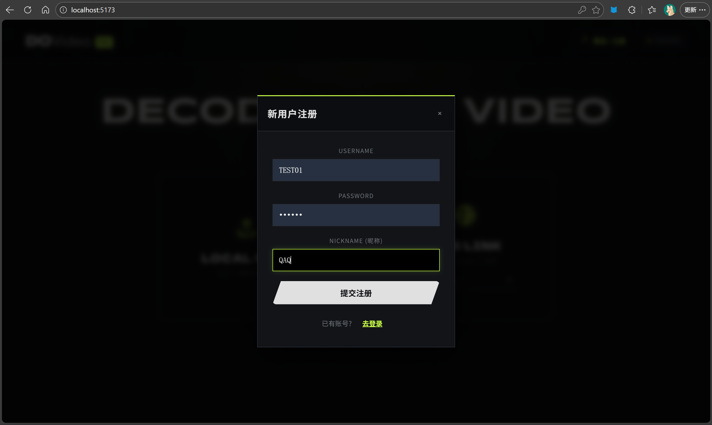
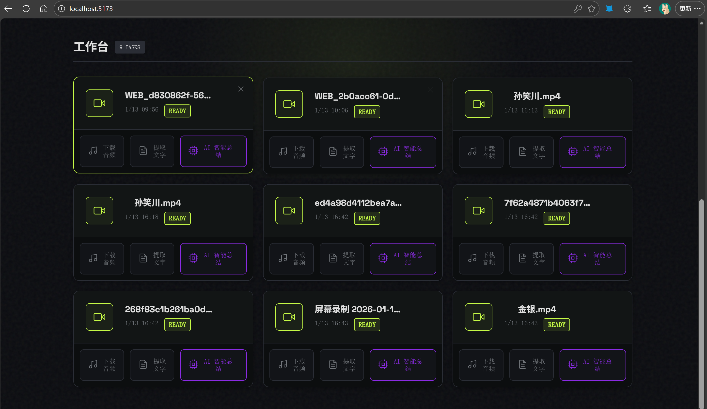

<div align="center">
  <h1>知帧 · FrameMind</h1>
  <p>长视频 → 结构化知识 · 可检索 · 可追溯 · 可追问</p>
  <p>
    <a href="https://github.com/linyanzhi591-afk/FrameMind/stargazers"></a>
    
    
    
    
    
    
    
    <a href="./LICENSE"></a>
  </p>
</div>

## 这是什么

知帧（FrameMind）是一个把长视频变成「可查、可问、可回看」知识的 Video Agent。

扔进去一节 40 分钟的课程录像，输入「总结二叉树遍历并出三道自测题」，它会返回结构化结论——每条都带原始视频里的时间戳，点一下就能跳回去看那段。结论没覆盖到的部分，你可以继续追问，它结合当前视频上下文作答。

核心矛盾在于：长视频天然耗时长、烧资源、模型调用贵。知帧的全部设计都在解这个矛盾。

## 它怎么工作

```
视频上传 → 分片+断点续传 → RocketMQ 异步消费 → 双分支抽取（ASR + OCR）
    → 时间轴融合为 VideoContext → 混合检索召回证据 → AgentLoop（规划→生成→校验）
    → 每条结论绑定时间戳 → SSE 推送结果 → 可继续追问
```

### 四个关键设计

**1. 提交即走，不阻塞用户**

上传走 5MB 分片 + Redis 断点记录，分析任务进 RocketMQ 队列，接口立刻返回 202。用户不用盯着等，弱网断了能续传。Redisson 按「内容指纹 + 目标」加锁，同一个任务不会被重复消费烧钱。

**2. 语音和画面双路并行，单路挂了照样跑**

FFmpeg 把音频切 60 秒片段送 ASR，同时检测场景变化抽关键帧送 OCR。两路用独立线程池并行，相邻画面用感知哈希去重。ASR 挂了 OCR 还在跑，反过来也一样——最后融合成统一的 `VideoSegment`，不依赖哪个模型的输出格式。

**3. 结论不能空口无凭**

AgentLoop 分三个角色：Planner 拆任务、Executor 出结论、Critic 检查覆盖度和时间戳证据。Critic 不通过就按缺失内容定向补检索，最多两轮——既给修正机会，又用轮次上限卡住成本。最终每条结论都能追溯到视频里的某一帧、某一句话。

**4. 长视频分段检索，断了能恢复**

每 5 分钟生成片段摘要 + 关键词 + Embedding，用关键词匹配和 Qdrant 语义召回选 TopK 证据。Qdrant 挂了就退化到本地关键词排序，不阻断主链路。Checkpoint 以 MySQL 为真源、Redis 为热缓存，进程崩了能从最近阶段恢复。

## 截图

| 登录注册 | 视频工作台 |
|:---:|:---:|
|  |  |

| Agent 目标输入 | Agent 分析结果 |
|:---:|:---:|
|  |  |

## 技术选型

| 层 | 选了什么 | 为什么 |
| :--- | :--- | :--- |
| 前端 | Vue 3 + Vite + SSE + Marked | 分片上传、实时进度、安全渲染 Markdown 结果 |
| 后端 | Java 21 + Spring Boot 3.5.9 + Undertow + MyBatis-Plus | 鉴权、媒体归属校验、任务编排 |
| 异步 | RocketMQ 5.3 + Redis 7 + Redisson | 削峰、热缓存、限流锁、消费幂等 |
| 存储 | MySQL 8 + MinIO + Qdrant | 业务数据、视频对象、向量检索 |
| 音视频 | FFmpeg + Tesseract | 音频切分、关键帧 OCR |
| AI | LangChain4j + DeepSeek + TeleSpeech ASR + BGE-M3 | Agent 推理、语音识别、文本向量化 |
| 部署 | Docker Compose | 一条命令拉起全部中间件 |

## 跑起来

### 前置条件

| 需要 | 版本 | 干什么用 |
| :--- | :--- | :--- |
| JDK | 21 | 后端 |
| Node.js | 22 | 前端构建 |
| Docker | Compose v2 | 拉中间件 |
| FFmpeg | 终端可调用 | 音频切分、关键帧 |
| Tesseract | 装 `chi_sim` + `eng` | 中英文 OCR |
| yt-dlp | 可选 | 解析在线视频链接 |

### 四步启动

```bash
# 1. 拷配置，填密钥
cp .env.example .env
#   至少改：DB/Redis/MinIO/Qdrant 密码 + SILICONFLOW_API_KEY

# 2. 拉中间件（MySQL Redis MinIO Qdrant RocketMQ）
./scripts/dev-up.sh

# 3. 起后端
cd server && ./mvnw spring-boot:run
#   默认 http://localhost:9090，curl http://localhost:9090/health 确认

# 4. 起前端
cd client && npm ci && npm run dev
#   默认 http://localhost:5173
```

只想看前端工作台不跑后端？打开 `http://localhost:5173/?demo` 用内置示例数据。

### 默认 LLM

`deepseek-ai/DeepSeek-V3.2`，通过硅基流动调用。`LLM_TIMEOUT_SECONDS` 默认 300 秒，避免长视频证据分析过早超时。改了模型或超时要重启后端。

### 中间件只听本机

默认全部绑定 `127.0.0.1`，不暴露到局域网。要远程部署再改 `SERVER_ADDRESS` + 反向代理。

### 排错速查

| 现象 | 怎么办 |
| :--- | :--- |
| 连不上 MySQL/Redis | `docker compose --env-file .env ps` 看健康状态，核对 `.env` 密码 |
| 页面说连不上后端 | 先 `curl /health`，再看 `VITE_DEV_PROXY_TARGET` |
| 解析报命令不存在 | 确认 `ffmpeg`、`tesseract` 在 PATH，或设 `FFMPEG_DIR`、`OCR_COMMAND` |
| AI 返回 401 | 检查 `SILICONFLOW_API_KEY` 和模型名，改完重启 |
| Maven 报 `maven-default-http-blocker` | `./mvnw -s .mvn/central-settings.xml spring-boot:run` 绕过失效镜像 |

### 停服务

```bash
docker compose --env-file .env down
```

不删数据卷。要完全重置：`down --volumes` + 手动清 `mysql/data`、`redis/data`、`minio/data`、`qdrant/data`。

## 代码在哪

```
FrameMind/
├── client/       # Vue 3 工作台（上传、进度、结果展示、追问）
├── server/       # Spring Boot（鉴权、媒体、任务编排、AgentLoop、消费者）
├── extension/    # 浏览器扩展，可选入口
├── rocketmq/     # Broker 配置
├── scripts/      # 开发脚本
├── .env.example  # 配置模板
└── docker-compose.yml
```

## 团队

**五等分的计科队**

| 学号 | 姓名 | 角色 |
| :--- | :--- | :--- |
| 3124007214 | 陈建志 | 需求与项目协调 |
| 3124004160 | 陈信儒 | 交互与前端 |
| 3124004184 | 肖琳瀚 | 后端与数据库 |
| 3124004159 | 陈康泓 | 原型与交互 |
| 3124004050 | 陈憬乐 | 测试与发布验证 |

## License

MIT，见 [LICENSE](LICENSE)。
